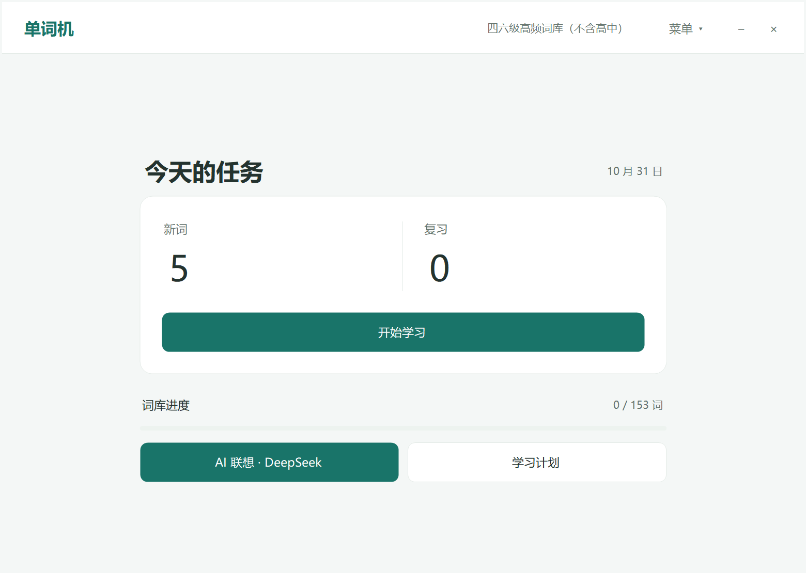
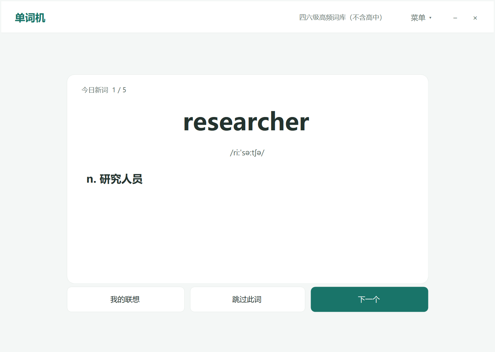
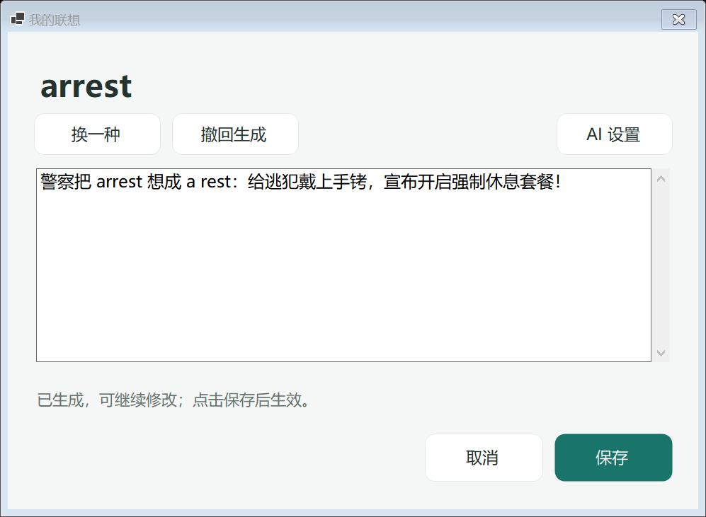

# 单词机 · 社区版

世界上最棒的懒人四六级单词机

## 下载与使用

**[下载 Windows x64 运行包](https://github.com/Jhon-FU/Fu-repository/releases/latest/download/WordMachineCommunity-win-x64.zip)** · [全部版本与更新说明](https://github.com/Jhon-FU/Fu-repository/releases)

1. 下载 `WordMachineCommunity-win-x64.zip`，完整解压到准备长期使用的文件夹。
2. 打开文件夹中的 `WordMachineCommunity.exe`，首次运行选择词库。
3. 需要开机启动时，在软件菜单中开启；需要撤销时，运行同目录的 `撤销开机自启动.cmd`。

运行包自带 .NET 运行时，无需安装开发工具或另行安装 .NET。当前提供 Windows x64 版本。Release 页的 `Source code (zip)` / `Source code (tar.gz)` 是源码，直接使用请下载上述运行包。每个版本同时提供 `SHA256SUMS.txt` 校验文件。

运行包不含任何人的学习记录或 API Key。更新前退出旧程序并备份自己的数据；默认学习数据保存在 `%LOCALAPPDATA%\WordMachineCommunity\`，解压新程序不会替换这些记录。

本版本从个人版独立整理；代码、数据目录和运行实例均独立。它不读取个人版的账号。开机自启动由用户在菜单中一键开启，首次运行不会自动注册。无需登录，学习记录保存在本机，导入文件不会上传。

## 当前实现

- **强制学习**：开机自启动，做不完关不掉（通过任务管理器可以紧急关闭）
- **简洁词卡**：没有pvp，没有广告，没有虚拟宠物。只有英文，读音，中文意思和单词检测，不要求会写，只要求会认（根据四六级考试性质决定）。
- **错题悬浮卡**：错题自动产生一个卡片窗口，始终置顶，只有完成一次单词检测才能隐藏一个小时。
- **学习计划**：从首页入口或“菜单 → 学习计划”设置每日数量、考试日期和学完日期；取消不保存，已开始的今日任务保持原配额。
- **熟词滚蛋**：当你刷到很熟悉的词，你知道自己看这个完全浪费时间时，可以点击“跳过此词”，这个单词就会被你“拉黑”，并且自动补上新单词，确保不会浪费你时间。（如果错误拉黑也可以在菜单处恢复）
- **AI联想**：可以接入deepseek的apikey，调用ds来给你产生联想记忆内容，帮助你记忆，本单词机的单词记忆主要原理就是通过自己写或者让ai写联想记忆内容，让你对单词产生记忆点，绝对的高效。
- **按需说明**：词库来源、导入格式和使用帮助集中到独立入口；成功提示自动收起，保存错误保留以便重试。完成页可结束学习、查看记录、复习或再测错词。
- **词库管理**：右上角“菜单 → 词库管理”进入；首次运行会打开词库选择窗口。
- **五种推荐词库**：纯四级 570 词、四级高频 63 词、纯六级 1,363 词、六级高频 90 词、四六级高频合并 153 词。
- **本地导入**：CSV、TSV、TXT、JSON、XLSX；也可直接粘贴从 Excel 复制的两列内容。
- **预览和校验**：显示有效词数、重复行、错误行；有错误时不能确认导入。同名词库不会互相覆盖。
- **安全切换**：每个词库独立保留词条快照、进行中的任务、答案、进度、跳过列表和个人联想；切回来可继续。首次使用新词库时，可选择复制已有的同词同义学习进度。后续两库独立更新。
- **导出**：JSON 保留完整词条字段；CSV 便于编辑和分享。

“纯”是所选分级词表的差集，不是官方独立词库认证。当前五库均排除高中及所记录的基础词形；高频词使用对应考试的阅读样本，条件为至少 3 个考期、跨至少 2 年、累计出现至少 5 次。**不把字幕词频、词典星级或个人已学词当作考试高频依据。** 由于排除范围和阈值较严格，增量高频库词数较少。完整来源、范围和局限见 [词库说明](docs/WORD_BANKS.md)。

支持在菜单中一键添加开机自启动，通过程序目录中的 CMD 撤销。当前已完成首页、词卡、检测、结果与管理窗口的界面整理；可选拼写检测尚未包含，学习检测仍沿用词义回忆流程。


## 界面预览

以下截图使用独立演示账号，不含个人学习记录。





## 运行与构建

开发环境：Windows、.NET 9 SDK。程序目标为 Windows x64；自包含发布包无需另行安装 .NET 运行时。

```powershell
dotnet run --project src/Cet6WordMachine/Cet6WordMachine.csproj

# 生成可直接运行的程序，输出到 artifacts/release
powershell -ExecutionPolicy Bypass -File scripts/build.ps1

# 从当前 Git 提交打包版本化运行包和 SHA256 校验文件（需要 PowerShell 7）
pwsh -File scripts/package-release.ps1 -Version 0.1.0

# 运行调度回归和词库专项测试（使用独立临时账号）
powershell -ExecutionPolicy Bypass -File scripts/test.ps1

# 从仓库内的来源快照重建五种推荐词库，需要 Python 3.10+
python scripts/build_wordbanks.py
python scripts/verify_wordbanks.py
```

首次构建需要还原 .NET 运行时包。项目不依赖付费词典 API；日常学习、词库导入和导出均可离线完成。

维护者推送 `v主版本.次版本.修订版本` 标签后，Release 工作流会先验证词库和运行回归测试，再构建自包含运行包并发布到 GitHub Releases。对应更新说明放在 `docs/releases/<标签>.md`。普通代码推送仍只运行构建与测试，不会自动发布新版本。

## 错题卡与答题隐藏

错题卡保持置顶，拖动标题栏时整张卡片都限制在一个屏幕的可用区域内，不会被拉出屏幕，也不会落到任务栏后面。多屏时可随鼠标移到另一块屏幕，并限制在该屏幕范围；显示设置变化后会重新校正位置。长错题列表在卡片内部滚动。

点击卡片上的“答题隐藏 1 小时”后，从当前错词中随机抽查一词。先输入中文意思，再查看参考释义，沿用正式检测的三个自评选项：只有“基本说对”通过，隐藏一小时。其余选项、想不起来或取消都保持显示，从本次结束开始等待两分钟，期间禁用再次答题按钮并显示倒计时。答题时卡片上的释义暂时遮住，窗口仍保留。

普通关闭和最小化不能用于绕过卡片；软件完成日常任务后的退出、系统关机和任务管理器结束进程仍沿用原来的行为。软件运行且仍有错题时，一小时到期后自动显示卡片，不抢走输入焦点。

休息截止时间单独保存在数据目录的 `mistake-widget.json`，重启后按剩余时间继续，切换词库或新增错词不会重置已获得的休息和冷却。本次抽查不修改正式成绩、答案或复习安排。读写该状态失败时保持卡片显示；答题过程中如果词库、日期或当前抽中的错题发生变化，会取消过期题目，避免它错误地授予隐藏时间。

## AI 联想（可选）

1. 打开 **菜单 → AI 设置**，填写自己的 DeepSeek API Key，选择模型。可先点“测试连接”，再保存。
2. 在词卡的 **我的联想** 中点击 **AI 生成**。没有 Key 时会先打开设置；设置后需再次明确点击生成。
3. 可以手动修改、点击“换一种”重新生成，或“撤回生成”恢复上一次生成前的内容。只有点击 **保存** 才写入当前词库的个人联想。

内置提示词鼓励天马行空、幽默、荒诞但有内在逻辑的画面，连接单词与词义，突出一个记忆点；**80 字以内，不设最低字数**。虚构拆词只能作为记忆技巧，不能冒充真实词源。

只有明确点击生成才请求联想接口，发送当前单词、音标和释义，不发送原联想、例句、答案、学习历史或整个词库。测试连接仅查询模型列表。API 费用由使用者自己的账号承担；没有自动批量生成或自动重试。

Key 使用 Windows 当前用户的 DPAPI 加密，单独保存在 `%LOCALAPPDATA%\WordMachineCommunity\ai\deepseek-settings.dat`，便携模式也不写到程序旁的学习存档中。清空 Key 并保存可移除配置；换 Windows 账号或电脑后需重新配置。详情、接口参考和失败处理见 [AI 联想说明](docs/AI_HINTS.md)。

以下界面使用本地模拟结果展示，并非真实 API 生成质量的测试。



## 导入自己的词库

至少包含“单词、释义”两列。可选列为音标、联想、例句。推荐使用 [CSV 模板](examples/wordbank-template.csv) 或 [JSON 模板](examples/wordbank-template.json)。

```csv
word,meaning,phonetic,hint,example
adapt,v. 适应；调整,,,
benefit,n. 益处；v. 使受益,,,
```

中文表头 `单词,释义,音标,联想,例句` 也可使用。没有表头时按上述顺序读取。只有单词、没有释义的文件不会猜测补齐，需补充释义后再导入。

- CSV/TSV/TXT 支持 UTF-8、带 BOM 的 UTF-16，并兼容 GB18030 文本。
- XLSX 读取第一张工作表，支持共享字符串和行内字符串；公式需先转换为值。旧版 XLS 请另存为 XLSX。
- 至少 1 词，最多 50,000 词；文件最大 20 MB。词条支持英文短语、连字符和撇号。
- 大小写不同、其他内容完全相同的重复行会合并；同词不同内容会提示错误，防止静默覆盖。
- 自定义导入不应用内置高中排除表，按用户提供的内容学习。
- 预览最多显示 200 个词，学习与导出使用全部词条。
- CSV 导出会对公式样式文本加单引号保护；需要完整往返保存时使用 JSON。

## 开机自启动与每日任务

将程序放在打算长期使用的文件夹，运行正式版，点击右上角 **菜单 → 一键开启开机自启动**。写入成功后显示“开机自启动已添加”，下次登录当前 Windows 账号时会打开单词机；无需管理员权限。每日任务完成前拦截普通关闭操作的行为保持不变，任务管理器和系统关机仍可正常使用。

软件菜单不提供关闭自启动的按钮。需要撤销时，双击 EXE 同目录的 **`撤销开机自启动.cmd`** 即可；重复执行也有效。它只删除社区版的启动项，不关闭当前程序、不删除学习记录，也不改动个人版启动项。撤销后重新打开软件不会自动添加回来。

- 自启动只作用于当前 Windows 用户，使用独立的 `HKCU\Software\Microsoft\Windows\CurrentVersion\Run\WordMachineCommunity` 值。
- 便携模式会保留 `--portable`，开机后继续使用程序目录的 `data/`。
- 移动程序目录后，打开新位置的 EXE，再点击菜单中的“更新开机自启动到当前程序”。
- 如 Windows 的启动应用设置或安全策略禁用了该程序，需在系统中恢复允许；菜单显示的是启动项是否已添加。
- 测试版和诊断模式禁用注册操作；构建与测试不会替你开启实际启动项。
- `scripts/build.ps1` 会把撤销 CMD 一起放入发布目录，请将它与 EXE 一同分发。

Windows 的 Run 启动机制在用户登录后运行，系统可能延后调度，具体时机由 Windows 决定。开发参考：[Microsoft Run and RunOnce Registry Keys](https://learn.microsoft.com/en-us/windows/win32/setupapi/run-and-runonce-registry-keys)。

## 数据与进度

默认数据目录：`%LOCALAPPDATA%/WordMachineCommunity/`。

```text
progress.json        当前词库及其他已用词库的完整学习状态
progress.json.bak    上一次成功保存的备份
mistake-widget.json 错题卡隐藏和重试的截止时间（独立于学习成绩）
wordbanks/           用户确认导入的词库
```

切换词库不会删除原任务。已使用词库优先采用其保存的词条快照，以保护历史释义与答案；本版不自动替换已经开始使用的词库内容。每日数量、考试日期和自定义学完日期属于全局计划设置，推荐数量按当前词库计算。

首次复制进度仅匹配**单词和完整释义都相同**的词条；不同释义不会直接标为已学。不会把旧库的任务、分数或跳过列表复制成新库的任务。

备份时退出程序，复制整个数据目录。迁移时恢复整个目录；不要只复制 `progress.json` 后删除自己导入的源词库。存档读取失败会提示并停止载入，不会用空账号覆盖已有文件。

调试可使用 `WORD_MACHINE_COMMUNITY_DATA_DIR` 和 `WORD_MACHINE_COMMUNITY_TODAY`。它们与个人版的环境变量不同。测试版项目 `src/TestVersion` 使用独立 `test-data`，支持模拟下一天；不要将其指向日常账号。

## 仓库结构

```text
src/              正式版、测试版源码
data/recommended/ 五种随程序嵌入的词库
data/sources/     紧凑来源快照、考频统计和校验信息
tests/            调度回归、导入/切换/界面专项测试
scripts/          构建、测试、词库重建与校验
examples/         导入模板
docs/             词库方法和验证说明
licenses/         第三方授权原文
.github/workflows/ Windows 构建与测试
```

不包含个人存档、原项目交接文件、旧版发布包、淘汰版本、原始真题全文或下载缓存。`artifacts/`、`.local/`、`bin/`、`obj/` 等生成目录被 Git 忽略。

## 开源许可与贡献

本社区版代码按 **GPL-3.0-only** 发布，见 [LICENSE](LICENSE)。ECDICT 词条保留 MIT 声明，其他来源和素材范围见 [THIRD_PARTY_NOTICES.md](THIRD_PARTY_NOTICES.md)。许可证不表示本项目拥有原考试文章、第三方词典品牌或原始教材的权利；仓库只包含所说明的词条字段、排除名单和统计证据，不附考试全文。

提交问题请提供程序版本、操作步骤、词库格式和已去除个人信息的最小示例。请勿提交真实学习存档或包含个人内容的联想、答案。修改调度或存档代码时，应运行全部测试。
